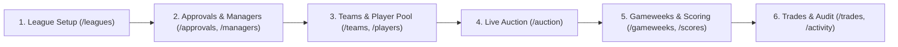
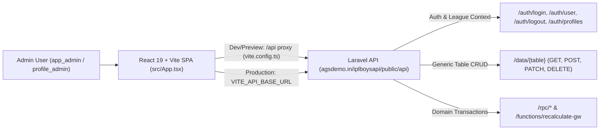

# Fantasy World Admin Console (`ipl-boys-crm`) — Complete Project Audit & Technical Report

**Project Package Name:** `fantasy-world-admin` (`v1.0.0`)
**Repository Path:** `d:\JOB_PROJECTS\ipl-boys-crm`
**Report Date:** November 25, 2026
**Prepared From:** Full codebase inspection (`src/`, configs, `git log`), TypeScript check (`tsc -b`), Prettier check, and Vite production build.

---

## 1. Project Overview

### 1.1 What Is This Project?

**IPL Boys CRM (`fantasy-world-admin`)** is the internal **Operations & League Administration Control Room** for the **Fantasy World** IPL fantasy cricket platform. While players and team managers interact with their own manager-facing app to manage lineups and bids, league organizers and super-administrators use this CRM to run the entire fantasy season from pre-auction setup through weekly match scoring, player trading, and final leaderboards.

In short, this CRM is the **single source of operational control** for:

- **League Onboarding & Governance:** Creating isolated fantasy league environments (`game_profiles`), configuring auction purses, squad size limits (`roster_min` / `roster_max`), tier weight rules, negative-score policies, and tactical chips (`TC`, `MMC`, `WC`, `FH`, `BB`).
- **User Access & Team Ownership:** Reviewing new manager signups (approve/deny), linking approved managers to fantasy franchises (`user_team_assignments`), and issuing temporary password resets.
- **Catalog & Live Auction Operations:** Maintaining IPL franchises and the player pool (roles, tiers, weights, base prices), recording live auction sales, and auditing team purses in real time.
- **Weekly Season Operations:** Scheduling gameweeks and submission deadlines, unlocking lineups when overrides are needed, entering match-by-match player scorecard stats and admin bonus/penalty adjustments (e.g., Straddle `±150`), recalculating gameweek points/ranks, reviewing pending player/cash trades, and monitoring an audited activity log.

### 1.2 End-to-End Operational Lifecycle

1. **League Setup (`/leagues`):** An `app_admin` creates a league profile (`starting_budget`, roster bounds, chips, weight tolerance) or adjusts rules for an existing league.
2. **Manager Onboarding (`/approvals` -> `/managers`):** New signups stay pending until approved by an `app_admin`, then get mapped to a fantasy team in the selected league.
3. **Catalog & Franchise Setup (`/players`, `/teams`):** `app_admin` maintains the IPL franchise catalog and player pool; admins register fantasy teams inside each league.
4. **Live Auction (`/auction`):** During the auction, admins filter unsold players, verify purse impact in real time (`AuctionSummary`), and commit sales via `execute_auction_sale`.
5. **Weekly Match Cycle (`/gameweeks`, `/scores`):** Admins activate a gameweek, lock/unlock deadlines, enter scorecard stats (`player_match_stats`) and manual bonuses (`admin_bonuses`), and trigger server-side point recalculation (`recalculate-gw`).
6. **In-Season Transfers & Monitoring (`/trades`, `/activity`):** Admins accept or cancel pending trades (`execute_trade` / `admin_cancel_trade`) and audit all league events in the activity log.

### 1.3 Control Room Dashboard (`/overview`)

The landing screen after sign-in (`src/modules/overview/pages/overview-page.tsx`) provides a real-time operational snapshot for the currently selected league:

- **Active Season Status Pill:** Displays the active gameweek name and whether submissions are `Open` or `Locked` (or `No active gameweek`).
- **4 Interactive KPI Metric Cards (`MetricCard`):**
  1. _Fantasy teams_ — count of teams registered in the selected league (links to `/teams`).
  2. _Pending approvals_ — count of unapproved manager signups with attention highlight (links to `/approvals` for `app_admin`).
  3. _Active gameweek_ — current active week name and formatted deadline/lock time (links to `/gameweeks`).
  4. _Pending trades_ — count of open trade requests awaiting admin decision (links to `/trades`).
- **Quick Actions Panel (`QuickActions`):** One-click shortcuts to Review signups (`app_admin`), Open auction desk, Manage gameweeks, Review trades, and League rules.
- **Gameweek Calendar Preview:** Displays the first 5 gameweeks (`name`, `deadline`, `is_active`, `is_locked`).
- **Active League Profile Switcher (`ProfileCards`):** Lets admins switch between available league profiles directly from the dashboard.

---

## 2. Executive Summary & Technical Health

`ipl-boys-crm` (branded in the UI as **Fantasy World · Control Room**) is a standalone **React 19 + TypeScript + Vite** administrator CRM/operations console for managing private IPL fantasy auction leagues.

The application contains **no direct database connection or SQL credentials**. Instead, it acts as a thin, role-gated client SPA communicating over HTTP/JSON with an external **Laravel REST/RPC backend** (`https://agsdemo.in/iplboysapi/public/api`). All authoritative business rules (auction purse validation, roster caps, trade weight tolerances, and gameweek score recalculation) are executed server-side by the Laravel API.

### Current Health Snapshot

| Check / Dimension                            | Status                               | Notes                                                                                                                                                   |
| -------------------------------------------- | ------------------------------------ | ------------------------------------------------------------------------------------------------------------------------------------------------------- |
| **TypeScript (`bun run typecheck`)**         | Passing                              | `tsc -b` exits with code `0` and strict checks (`strict`, `noUnusedLocals`, `noUnusedParameters`).                                                      |
| **Production Build (`bun run build`)**       | Passing (with warning)               | Builds in `349ms` (`2505` modules). Emits a chunk-size warning (`dist/assets/index-t2hzCViW.js` is `649.78 kB` / `217.86 kB` gzip; threshold `500 kB`). |
| **Code Formatting (`bun run format:check`)** | Failing (7 files)                    | `prettier --check .` exits with code `1` due to formatting drift in 7 files.                                                                            |
| **Automated Tests**                          | Missing                              | No unit, integration, or E2E test runner (`vitest`, `playwright`, etc.) is configured.                                                                  |
| **Core CRM Functionality**                   | Operational (with UX/edge-case gaps) | All 13 domain modules are wired to API endpoints; several tables display raw UUIDs and lack Edit/Delete/Pagination.                                     |

### Technology Stack

| Layer                   | Technology / Library                                                                       | Version (`package.json`)               |
| ----------------------- | ------------------------------------------------------------------------------------------ | -------------------------------------- |
| UI Framework            | React / React DOM                                                                          | `19.3.1`                               |
| Language                | TypeScript                                                                                 | `7.0.2`                                |
| Build & Dev Server      | Vite (`@vitejs/plugin-react`)                                                              | `8.3.8` / `6.3.0`                      |
| Styling & UI Kit        | Tailwind CSS (`@tailwindcss/vite`), `tw-animate-css`, shadcn/ui (`radix-nova`), `radix-ui` | `4.3.5` / `1.4.0` / `4.23.0` / `1.8.1` |
| Server State & Caching  | TanStack React Query (`@tanstack/react-query`)                                             | `5.108.4`                              |
| HTTP Client             | Axios                                                                                      | `^1.21.1`                              |
| Routing                 | React Router DOM (`react-router-dom`)                                                      | `^7.18.6`                              |
| Notifications & Theming | `react-hot-toast`, `next-themes`                                                           | `^2.6.1` / `^0.4.6`                    |
| Icons & Visual Effects  | `lucide-react`, `@paper-design/shaders-react` (`GrainGradient`)                            | `1.79.0` / `0.0.67`                    |
| Formatting              | Prettier + `prettier-plugin-tailwindcss`                                                   | `3.10.1` / `0.8.1`                     |

---

## 3. How the CRM Works (Architecture & Data Flow)

### 3.1 Bootstrapping & Global Providers (`src/main.tsx`)

On mount, `src/main.tsx` wraps `<App />` in:

1. `ThemeProvider` (`next-themes`, `attribute="class"`, `defaultTheme="dark"`, `enableSystem`).
2. `QueryClientProvider` (`src/lib/query-client.ts`) configured with:
   - `staleTime: 30_000` (30s)
   - `retry: 1`
   - `refetchOnWindowFocus: false`
   - Global `QueryCache.onError` handler that automatically triggers `toast.error(...)` when any query fails.
3. `SessionProvider` (`src/modules/auth/hooks/use-session.tsx`) managing bearer authentication and role checks.
4. `BrowserRouter` (`react-router-dom`) + `AppToaster` (`src/shared/components/app-toaster.tsx`).

### 3.2 Authentication & Role-Based Access Control (RBAC)

- **Token & User Persistence (`src/lib/storage.ts`):** Stores `fantasy_world_admin_token` and `fantasy_world_admin_user` in `localStorage`.
- **Login Flow (`authApi.login`):** Sends `POST /auth/login` with `{ email, password }`. On success, verifies `hasAdminRole(user)` (`app_admin` or `profile_admin`). Non-admin accounts are immediately rejected client-side, tokens cleared, and redirected/blocked.
- **Session Validation (`SessionProvider`):** If a token exists in `localStorage`, `GET /auth/user` runs in the background (`retry: 0`). If `/auth/user` fails, tokens and React Query cache are cleared.
- **Route Guards (`src/App.tsx`):**
  - `RequireAdmin` (`src/modules/shell/components/require-admin.tsx`): Redirects unauthenticated users to `/login` and authenticated non-admins to `/unauthorized`.
  - `AppAdminRoute` (`src/modules/shell/components/app-admin-route.tsx`): Restricts `/approvals` and `/managers` strictly to `app_admin`; `profile_admin` users are redirected to `/overview`.

| Capability / Route                                                   | `app_admin`                                       | `profile_admin`                                 |
| -------------------------------------------------------------------- | ------------------------------------------------- | ----------------------------------------------- |
| `/overview`, `/auction`, `/scores`, `/trades`, `/teams`, `/activity` | Full access                                       | Full access (league-scoped)                     |
| `/approvals`, `/managers`                                            | Full access                                       | Hidden in sidebar & blocked via `AppAdminRoute` |
| `/leagues`                                                           | Edit selected league + Create new league profiles | Edit selected league settings only              |
| `/players`                                                           | View catalogs + Add IPL franchises & players      | View catalogs only (Add buttons hidden)         |
| `/gameweeks`                                                         | Create gameweeks, Set active, Unlock, Recalculate | View gameweeks & Recalculate only               |

### 3.3 Multi-League Context (`AdminProvider`)

- `src/modules/shell/context/admin-context.tsx` fetches accessible league profiles from `GET /auth/profiles`.
- Automatically selects `profiles[0].id` when `profileId` is empty.
- Users switch active leagues via the Topbar `<select>` (`src/modules/shell/components/topbar.tsx`) or the Overview `ProfileCards` (`src/modules/overview/components/profile-cards.tsx`).
- `AdminLayout` (`src/modules/shell/components/admin-layout.tsx`) keys `<section className="content" key={profileId}>`, forcing a clean remount of page state whenever the active league changes.

### 3.4 HTTP & Data Access Layer

- **Axios Client (`src/lib/axios.ts`):**
  - Uses `/api` when `import.meta.env.DEV` is true (proxied by `vite.config.ts` to `https://agsdemo.in/iplboysapi/public/api` via `rewrite: (path) => path.replace(/^\/api/, "/iplboysapi/public/api")`).
  - Uses `import.meta.env.VITE_API_BASE_URL || "https://agsdemo.in/iplboysapi/public/api"` in production builds.
  - Attaches `Authorization: Bearer <token>` on every request and normalizes errors into `ApiError(message, status)`.
- **Generic Table & RPC Layer (`src/shared/api/table.api.ts`):**
  - `tableApi.list(table, params)` -> `GET /data/{table}`
  - `tableApi.insert(table, row)` -> `POST /data/{table}`
  - `tableApi.update(table, id, row)` -> `PATCH /data/{table}?eq[id]={id}`
  - `tableApi.remove(table, id)` -> `DELETE /data/{table}?id={id}`
  - `tableApi.rpc(name, args)` -> `POST /rpc/{name}`
  - `tableApi.recalculate(profile_id, gameweek_id)` -> `POST /functions/recalculate-gw`
- **Shared Hooks (`src/shared/hooks/`):**
  - `useRows(table, params, fetcher)`: Wraps `useQuery` with `placeholderData: (previous) => previous` and exposes `{ rows, loading, error, setRows }`.
  - `useRefreshData()`: Calls `queryClient.invalidateQueries()` from the Topbar refresh button.

---

## 4. Existing Modules & Functionalities

The application is organized into **13 domain modules** under `src/modules/` plus shared utilities in `src/shared/` and `src/lib/`.

| #   | Module (`src/modules/`) | Route                     | Access                                           | Backend Tables / Endpoints Used                                                                            | Implemented Functionalities                                                                                                                                                                                                                                                                             |
| --- | ----------------------- | ------------------------- | ------------------------------------------------ | ---------------------------------------------------------------------------------------------------------- | ------------------------------------------------------------------------------------------------------------------------------------------------------------------------------------------------------------------------------------------------------------------------------------------------------- |
| 1   | `auth`                  | `/login`, `/unauthorized` | Public / Authed                                  | `/auth/login`, `/auth/user`, `/auth/logout`                                                                | WebGL shader login UI, email/password sign-in, password visibility toggle, role validation, sign-out, unauthorized fallback screen.                                                                                                                                                                     |
| 2   | `shell`                 | Layout wrapper            | All admins                                       | `/auth/profiles`                                                                                           | Collapsible desktop sidebar, mobile slide-out drawer (`Esc`/backdrop close), sticky topbar with league switcher, global refresh button, dark/light/system `ThemeToggle`, user badge.                                                                                                                    |
| 3   | `overview`              | `/overview`               | All admins                                       | `fpl_teams`, `profiles`, `gameweeks`, `trades`                                                             | Live active gameweek status pill, 4 interactive KPI `MetricCard`s (Fantasy teams, Pending approvals, Active gameweek, Pending trades), QuickActions panel, top-5 Gameweek calendar table, clickable League Profile switcher cards.                                                                      |
| 4   | `approvals`             | `/approvals`              | `app_admin`                                      | `profiles` (`GET`, `PATCH`)                                                                                | Lists unapproved/non-rejected manager signups; one-click Approve (`approved: true, status: "approved"`) or Deny (`approved: false, status: "rejected"`) with optimistic list removal.                                                                                                                   |
| 5   | `managers`              | `/managers`               | `app_admin`                                      | `profiles`, `fpl_teams`, `user_team_assignments`, `rpc/assign_manager_to_team`, `rpc/admin_reset_password` | Assign approved managers to fantasy teams in selected league, remove team assignments, reset temporary manager passwords (min 8 chars + visibility toggle + live strength indicator), view current assignments.                                                                                         |
| 6   | `leagues`               | `/leagues`                | All admins (Create: `app_admin`)                 | `/auth/profiles`, `game_profiles` (`POST`, `PATCH`)                                                        | Edit selected league parameters (starting budget, `roster_min`/`roster_max`, `weight_trade_tolerance`, `weight_enabled`, `allow_negative_points`, clickable chip toggles `TC`/`MMC`/`WC`/`FH`/`BB`, JSON editors for `enabled_chips` and `release_cycles`); `app_admin` can create new league profiles. |
| 7   | `teams`                 | `/teams`                  | All admins                                       | `fpl_teams`, `ipl_teams`, `game_profiles` (`GET`, `POST`)                                                  | Lists fantasy teams (`name`, `owner`, `budget`, `squad_value`, `ipl_team_id`) for selected league; `CreateTeamForm` registers new fantasy teams pre-filled with profile `starting_budget`.                                                                                                              |
| 8   | `players`               | `/players`                | All admins (Add: `app_admin`)                    | `players`, `ipl_teams` (`GET`, `POST`)                                                                     | Lists IPL franchises (with color swatch badge) and player pool catalog (`limit: 500`); `app_admin` can add new IPL franchises (ID, name, short name, hex color) and players (name, role `BAT`/`WK`/`BOWL`/`AR`/`TEAM`, franchise, tier `glass`–`platinum`, weight `0–5`, base price).                   |
| 9   | `auction`               | `/auction`                | All admins                                       | `fpl_teams`, `players`, `player_assignments`, `rpc/execute_auction_sale`                                   | Live sale recorder (`AuctionForm`), real-time `AuctionSummary` financial purse audit (remaining balance & deficit warning), player name filter, base-price validation, unsold pool table (`unassigned.slice(0, 50)`).                                                                                   |
| 10  | `gameweeks`             | `/gameweeks`              | All admins (Create/Activate/Unlock: `app_admin`) | `gameweeks`, `rpc/set_active_gameweek`, `functions/recalculate-gw`                                         | Lists all gameweeks; `app_admin` can create gameweeks (`CreateGameweekForm`), set active gameweek, and override-unlock locked gameweeks; any admin can trigger server-side score recalculation for the active league.                                                                                   |
| 11  | `scores`                | `/scores`                 | All admins                                       | `player_match_stats`, `team_gw_scores`, `admin_bonuses`, `players`, `gameweeks`, `fpl_teams`               | `ScoreEntryForm` with 14 numeric stat inputs, 6 match outcome toggles, and form reset; Entered player match data table; Calculated team totals table (`points`, `total_points`, `rank`, `chip_applied`); `AdminBonusManager` to record/view manual `+/-` adjustments (e.g., Straddle `±150`).           |
| 12  | `trades`                | `/trades`                 | All admins                                       | `trades`, `rpc/execute_trade`, `rpc/admin_cancel_trade`                                                    | Lists trades (`created_at`, `type`, `from_team_id`, `to_team_id`, `status`, `cash_from`, `cash_to`) for selected league; Accept or Cancel `pending` trades via server RPCs with optimistic status updates.                                                                                              |
| 13  | `activity`              | `/activity`               | All admins                                       | `league_activity_log` (`GET`)                                                                              | Read-only audit log of recent league events (`created_at`, `activity_type`, `description`, `user_id`, `limit: 200`).                                                                                                                                                                                    |

---

## 5. What Is Working Correctly (Verified)

1. **Clean Compilation & Production Bundling:**
   - `bun run typecheck` (`tsc -b`) passes with zero errors under strict TypeScript settings.
   - `bun run build` succeeds cleanly and outputs production assets in `dist/`.
2. **Modular Feature Architecture:**
   - Clean separation across `api/`, `hooks/`, `components/`, `pages/`, and `types/` inside every module in `src/modules/`.
   - Centralized Axios client (`src/lib/axios.ts`) automatically injects bearer tokens and normalizes Laravel error payloads (`data.error` / `data.message`).
3. **Authentication & Route Protection:**
   - Dual-role gating (`app_admin` vs `profile_admin`) consistently hides restricted sidebar links (`Approvals`, `Managers & teams`), restricts admin-only buttons (`Add gameweek`, `Add player`, `Add franchise`, `Create league`), and blocks direct URL navigation via `AppAdminRoute`.
4. **Dual-Mode Design System & UX Polish:**
   - Full Light/Dark/System theme switching (`next-themes` + CSS variables in `src/styles.css`), Geist & Geist Mono typography with `tabular-nums`, responsive mobile navigation drawer, skeleton loading states in `DataTable` and `MetricCard`, and global toast notifications (`react-hot-toast`).
5. **Client-Side Guardrails & Optimistic Updates:**
   - `AuctionForm` enforces hammer price `>= base_price` and displays live purse impact in `AuctionSummary`.
   - `ManagersPage` blocks duplicate manager-to-team assignments client-side and enforces an 8-character minimum with live validation on password resets.
   - `ApprovalsPage` and `TradesPage` immediately update local query state (`setRows`) upon mutation success while invalidating React Query caches.

---

## 6. Issues Already Fixed (Git History Summary)

Auditing `git log` (from initial commit `66832dc` through `8610997`) confirms the following issues have already been resolved:

1. **Monolithic Codebase Refactored (`e3688ab`, `70c264c`):** Replaced the legacy ~2,700-line monolithic `src/App.tsx` and React 18 setup with React 19, shadcn/ui, Tailwind CSS v4, TanStack Query, and 13 modular domain folders.
2. **Design System, Dark Mode & Navigation Overhaul (`06e931a`, `1937ecb`, `3d9510d`, `ce7ac36`, `3adb38e`):** Fixed visual inconsistencies, added semantic status badges (`badge green/amber/red/neutral`), skeleton loaders, collapsible sidebar, accessibility `aria-*` attributes, and migrated typography to Geist / Geist Mono.
3. **Global Toast Feedback Migration (`97165c0`):** Replaced intrusive inline `FeedbackBanners` with `react-hot-toast` (`AppToaster`) and hooked `QueryCache.onError` so background fetch failures surface automatically.
4. **Local API Proxy & Timestamp Parsing Fixes (`0007e51`):**
   - Fixed local development CORS blocks by configuring Vite `server.proxy` and `preview.proxy` for `/api` -> `https://agsdemo.in/iplboysapi/public/api` and routing dev Axios calls through `/api`.
   - Hardened `formatDateTime` in `src/lib/format.ts` to handle SQL space-separated timestamps, fractional microseconds, and 2-digit timezone offsets (`+05`).
   - Fixed Radix `DropdownMenu` `modal` prop behavior.
5. **Auction Empty Teams Dropdown Bug (`69dd7aa`):** Added a disabled placeholder option (`"No fantasy teams in this league"`) in `src/modules/auction/components/auction-form.tsx` so newly created/empty leagues do not break selection state.
6. **Scores Raw UUID Readability & Form Reset (`ff46a86`):** Updated `ScoresPage`, `ScoreEntryForm`, and `AdminBonusManager` to display human-readable Gameweek and Team names instead of raw UUIDs, added `Reset form` buttons, and added loading/empty states to the team selector.
7. **Manager Password Reset UX (`8610997`):** Added password visibility toggle (`Eye`/`EyeOff`), live 8-character strength validation feedback, and `"Name · email"` labels in `ManagersPage`.

---

## 7. Pending Frontend Issues & Gaps

### High Priority (Functional / UX Bugs)

1. **Prettier Format Check Fails on 7 Files:**
   - Running `bun run format:check` fails (exit code `1`) on:
     - `src/main.tsx`
     - `src/modules/auction/pages/auction-page.tsx`
     - `src/modules/managers/pages/managers-page.tsx`
     - `src/modules/scores/components/admin-bonus-manager.tsx`
     - `src/modules/scores/components/score-entry-form.tsx`
     - `src/modules/shell/components/sidebar.tsx`
     - `vite.config.ts`
2. **Raw Database IDs Displayed Instead of Names in 5 Pages:**
   - `TeamsPage` (`src/modules/teams/pages/teams-page.tsx:51`): Shows raw `ipl_team_id` even though `franchises` is already fetched on line 14.
   - `PlayersPage` (`src/modules/players/pages/players-page.tsx:79`): Shows raw `ipl_team_id` instead of franchise name.
   - `AuctionPage` (`src/modules/auction/pages/auction-page.tsx:113`): Unsold pool table shows raw `ipl_team_id` (and hardcodes `loading={false}` on line 109 instead of `players.loading || assignments.loading`).
   - `TradesPage` (`src/modules/trades/pages/trades-page.tsx:64-65`): Shows raw `from_team_id` and `to_team_id` UUIDs instead of team names, and does not show the players/assets included in the trade.
   - `ActivityPage` (`src/modules/activity/pages/activity-page.tsx:25`): Shows raw `user_id` UUID in the `Actor` column instead of manager display name/email.
3. **Auction Filter Mismatch & Budget Deficit Submit:**
   - `AuctionForm` (`src/modules/auction/components/auction-form.tsx:129`) instructs `"Type to filter player name or franchise…"`, but `AuctionPage` (`src/modules/auction/pages/auction-page.tsx:35`) only filters on `player.name`, not franchise.
   - `AuctionForm` (`line 220`) disables submit only for `busy || !selectedPlayer || !selectedTeam || isBelowBase` — it allows submitting when `remainingBudget < 0` (`isDeficit` in `AuctionSummary`), relying entirely on server rejection.
4. **Queries Fired With Empty `profileId` on Initial Mount:**
   - Before `/auth/profiles` resolves, `AdminContext.profileId` is `""`. Hooks (`useOverviewData("")`, `useTeams("")`, `useAuctionTeams("")`, `useTrades("")`, `useActivity("")`, `useTeamScores("")`, etc.) immediately issue GET requests with `?profile_id=` because `useRows` (`src/shared/hooks/use-rows.ts`) has no `enabled` parameter.
   - Additionally, `useOverviewData` (`src/modules/overview/hooks/use-overview.ts:14`) fetches `pendingProfiles` even when logged in as a `profile_admin`.
5. **Shared `userId` State Across Two Forms in `ManagersPage`:**
   - `src/modules/managers/pages/managers-page.tsx:27` uses a single `userId` state for both `"Assign manager to team"` (line 110) and `"Reset manager password"` (line 147), so selecting a manager in one form silently changes the target manager in the other form.
6. **No 401 Session-Expiry Interceptor in Axios:**
   - `src/lib/axios.ts` converts `401` errors into `ApiError`, showing a toast, but does **not** clear `localStorage` or redirect the user to `/login` when a token expires mid-session.

### Medium Priority (Data Handling, Form Edge Cases & Missing CRUD)

7. **Silent Row Truncation & Missing Table Search/Pagination:**
   - `DataTable` (`src/shared/components/data-table.tsx`) has no client/server pagination, sorting, or search.
   - `playersApi.list` (`src/modules/players/api/players.api.ts:7`) uses `limit: "500"` while `auctionApi.players` and `scoresApi.players` use `limit: "1000"` (risk of `PlayersPage` missing players if catalog > 500).
   - `AuctionPage` (`line 108`) slices unsold players to `unassigned.slice(0, 50)` with no UI notice that rows beyond 50 are hidden.
   - `TradesPage`, `ActivityPage`, `ApprovalsPage`, and `AdminBonusManager` cap at `limit: "200"`.
8. **Missing Edit & Delete Workflows Across Core Tables:**
   - Admins can **create** but cannot **edit or delete** records in the UI for: Fantasy Teams (`TeamsPage`), Players & Franchises (`PlayersPage`), Entered Player Match Stats (`ScoresPage` — typos require manual DB/API fixes), Admin Bonuses (`AdminBonusManager`), or Gameweek deadlines/match counts (`GameweeksPage` only allows Set active, Recalculate, Unlock).
9. **`LeagueSettingsForm` Sync & Validation Issues (`src/modules/leagues/components/league-settings-form.tsx`):**
   - `useEffect` (`lines 53-55`) only depends on `[profile.id]`, not `[profile]`, so saving or refreshing data for the current league does not refresh form inputs from the latest query data.
   - Raw JSON textareas (`enabled_chips`, `release_cycles`) use `JSON.parse` without field-level validation; invalid JSON in `enabled_chips` silently resets chip state on toggle.
   - `CreateLeagueForm` (`line 41`) uses `Number(budget) || 5000`, which overrides an explicit `0` starting budget with `5000`.
10. **Gameweek Creation & Recalculate Guard Gaps:**
    - `CreateGameweekForm` (`src/modules/gameweeks/components/create-gameweek-form.tsx:26-27`) generates `id = gw${nextNumber}` (`max + 1`) and formats `deadline` as `form.deadline.replace("T", " ") + ":00"` with no timezone offset.
    - `GameweeksPage` (`line 114`) does not disable `Recalculate` when `profileId` is empty.

### Low Priority (Performance, Styling Consistency & Repo Hygiene)

11. **Bundle Size Warning (>500 kB JS Chunk):** `dist/assets/index-t2hzCViW.js` is `649.78 kB` (`217.86 kB` gzip) because pages and `@paper-design/shaders-react` are eagerly imported in `src/App.tsx` instead of using `React.lazy` route code-splitting.
12. **Mixed Styling Paradigms:** `LoginPage`, `AuctionForm`, `AuctionSummary`, `CreateLeagueForm`, and `LeagueSettingsForm` use Tailwind + shadcn/ui components (`Card`, `Button`, `Input`), whereas `ApprovalsPage`, `ManagersPage`, `TeamsPage`, `PlayersPage`, `GameweeksPage`, `ScoresPage`, `TradesPage`, `ActivityPage`, `RequireAdmin`, and `UnauthorizedPage` still use legacy custom CSS classes (`.panel`, `.add-form`, `.login-shell`, `.primary`, `.secondary`).
13. **Unused Scratch File & Redundant Package:** `shader-preview.tsx` sits in the repository root unused by the app; `package.json` depends on external `"cn": "0.5.2"` wrapped by `src/lib/utils.ts` (`export { cn } from "cn"`).
14. **Zero Automated Tests:** No unit tests for helpers (`formatDateTime`, `hasAdminRole`, `AuctionSummary` math) or component/integration tests exist.

---

## 8. Pending Backend, Security & Integration Issues

Because the Laravel backend (`https://agsdemo.in/iplboysapi/public/api`) lives outside this repository, the following backend/integration risks were identified from the frontend contract and environment setup:

1. **External Backend Opacity & Contract Coupling:**
   - There is no OpenAPI/Swagger spec or shared type schema in this repository. All table names (`profiles`, `game_profiles`, `fpl_teams`, `ipl_teams`, `players`, `player_assignments`, `user_team_assignments`, `gameweeks`, `player_match_stats`, `team_gw_scores`, `admin_bonuses`, `trades`, `league_activity_log`) and RPC names are hardcoded strings in `src/`. Any backend column/RPC change will silently break frontend views.
2. **Production CORS & Environment Configuration:**
   - Local development bypasses CORS via Vite's `/api` proxy (`vite.config.ts`). Production builds call `VITE_API_BASE_URL` directly, requiring Laravel's `CORS_ALLOWED_ORIGINS` to explicitly allow the deployed frontend origin.
3. **Security Hygiene — Local `.env` File:**
   - The local `.env` file (which is gitignored and **not** tracked in Git) currently contains plaintext `APP Admin` and `Profile Admin` login notes appended below `VITE_API_BASE_URL` in non-standard dotenv syntax. Credentials should be removed from `.env` and managed in a password manager.
4. **Server-Side Authorization on Generic `/data/*` Endpoints:**
   - Because the frontend invokes generic PostgREST-style endpoints (`GET/POST/PATCH/DELETE /data/{table}`), Laravel must strictly enforce:
     - `app_admin`-only access on `profiles` reads/writes, `user_team_assignments`, `players`, `ipl_teams`, `game_profiles` inserts, and `gameweeks` writes (especially since `OverviewPage` currently fires `GET /data/profiles?approved=0` even for `profile_admin` sessions).
     - Strict `profile_id` tenant scoping for `profile_admin` tokens so a `profile_admin` cannot read or mutate another league's `fpl_teams`, `player_match_stats`, `admin_bonuses`, or `trades` by changing query params.
5. **Client-Generated IDs & Timestamps:**
   - `CreateLeagueForm`, `CreateTeamForm`, `ScoreEntryForm`, and `AdminBonusManager` generate `crypto.randomUUID()` and `created_at` client-side, while `AddPlayerForm` uses `p${Date.now()}` and `CreateGameweekForm` uses `gw${nextNumber}`. The backend should ideally own primary key generation (or enforce uniqueness) and `created_at` timestamps, plus standardize UTC/IST handling for `gameweeks.deadline` (currently sent as a naive `"YYYY-MM-DD HH:MM:00"` string).
6. **Missing Backend Support for Pending Admin Operations:**
   - To enable editing/deleting erroneous match stats, bonuses, players, or fantasy teams, and to handle large catalogs/logs cleanly, the backend must expose/verify `PATCH`/`DELETE` permissions on those tables and support pagination metadata (`total` count / page cursor).

---

## 9. Recommended Next Steps

### Quick Wins (Frontend — Low Risk)

1. Run `bun run format` to resolve the 7 Prettier formatting violations and add CI checks for `typecheck`, `format:check`, and `build`.
2. Resolve raw UUIDs in `TeamsPage`, `PlayersPage`, `AuctionPage`, `TradesPage`, and `ActivityPage` using lookup maps (matching the pattern recently applied to `ScoresPage` in commit `ff46a86`).
3. Gate profile-dependent `useRows` queries on `enabled: Boolean(profileId)` (and `isAppAdmin` for `pendingProfiles`), separate `userId` state between the two forms in `ManagersPage`, and remove unused `shader-preview.tsx`.
4. Add a `401` response interceptor in `src/lib/axios.ts` to clear stale sessions and redirect to `/login`.

### Medium-Term Improvements (Frontend + Backend)

5. Add edit/delete dialogs for `player_match_stats`, `admin_bonuses`, `players`, `fpl_teams`, and `gameweeks` deadlines.
6. Add search, filtering, and pagination to `DataTable` + route-level `React.lazy` code-splitting to bring the JS bundle below 500 kB.
7. Align with the Laravel backend team on: server-side `profile_admin` tenant isolation audit, UTC/IST handling for gameweek deadlines, server-generated IDs/timestamps, and an API contract/OpenAPI document.
8. Add baseline automated tests (`Vitest` + React Testing Library) for auth/role guards, `formatDateTime`, and auction/score forms, and remove plaintext credentials from the local `.env` file.
